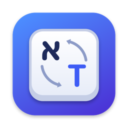
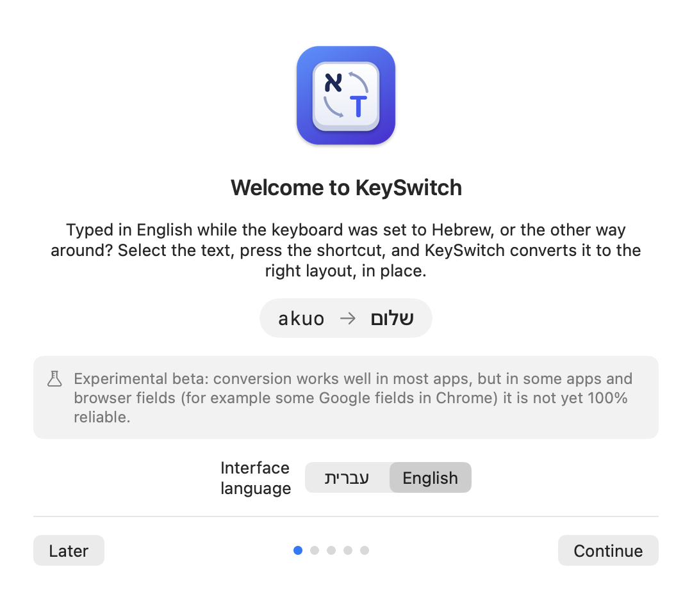
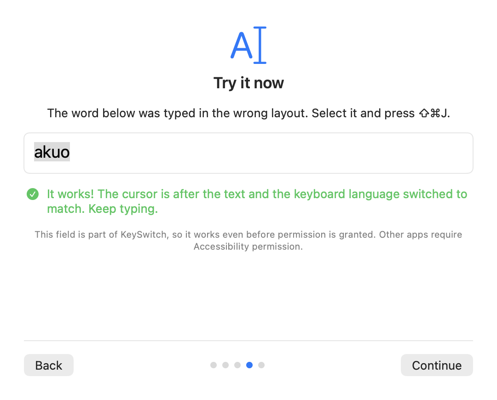
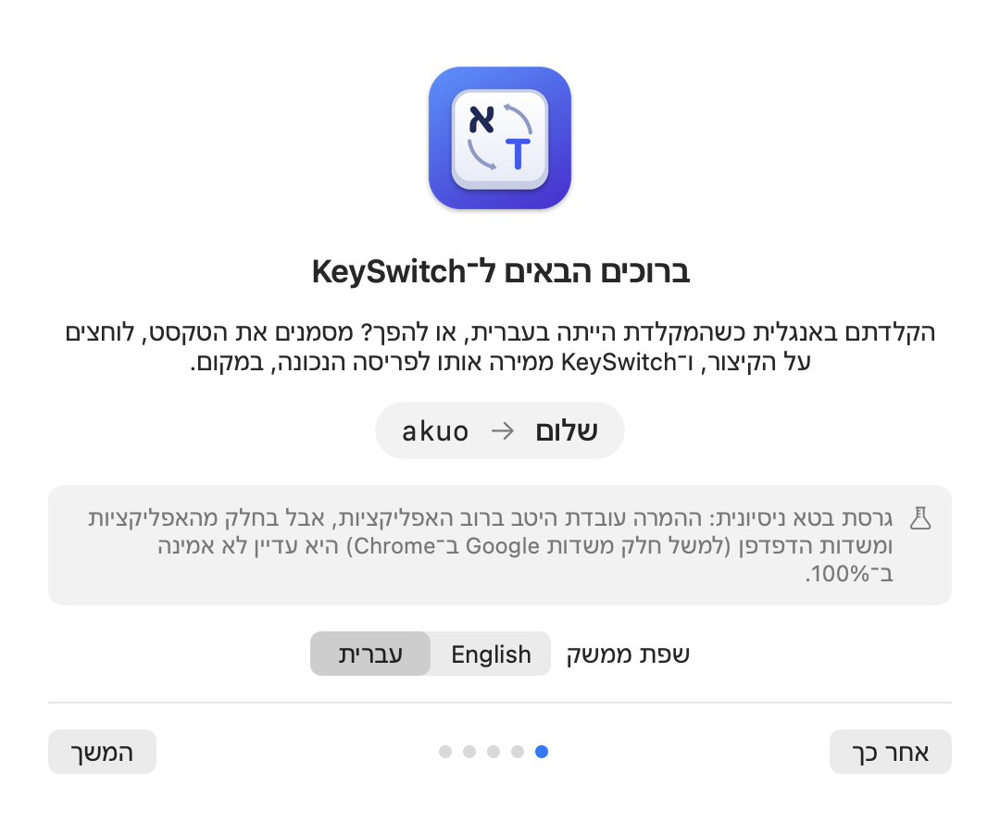
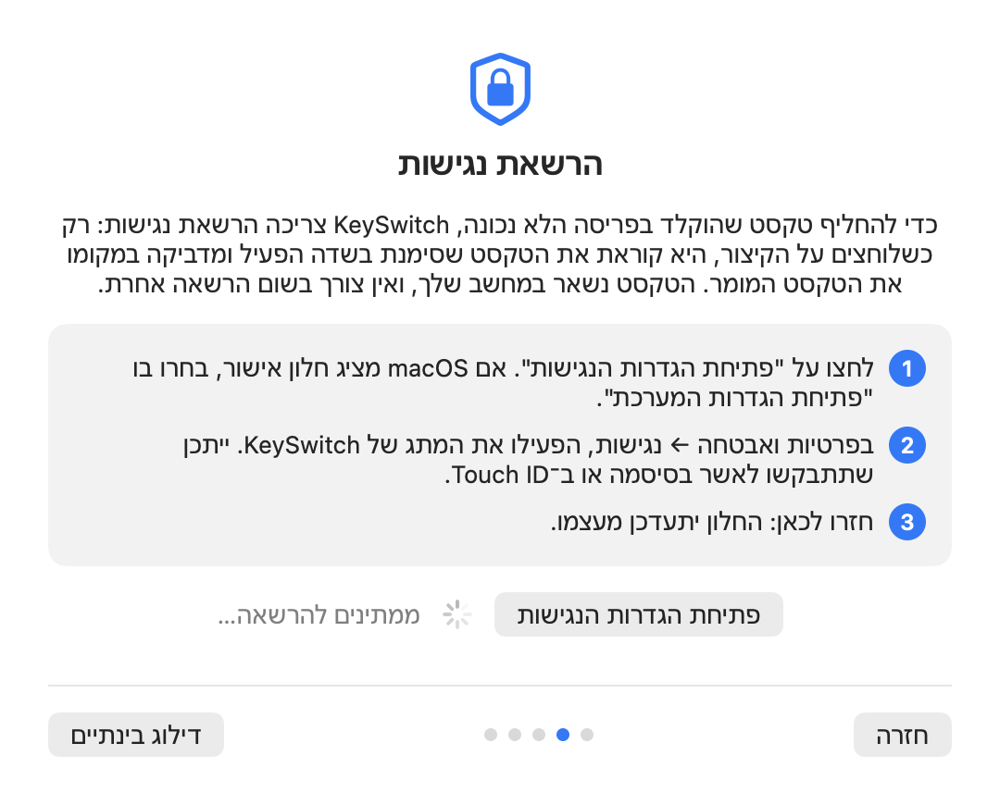

  

<h1 align="center">KeySwitch</h1>

  <b>Fix text typed in the wrong keyboard layout: Hebrew ⇄ English, in place, with one shortcut.</b> 
  A small, private menu bar utility for macOS.

  <a href="https://github.com/omryarad/KeySwitch/releases/download/v0.2.1-beta/KeySwitch-0.2.1.dmg"><b>⬇️ Download KeySwitch Beta 2.1 for Mac (DMG)</b></a> 
  macOS 13 or later · Apple Silicon and Intel · signed and notarized by Apple · updates itself automatically

  <a href="../../releases">All releases</a> ·
  <a href="INSTALL.md">Installation</a> ·
  <a href="PRIVACY.md">Privacy</a> ·
  <a href="../../issues/new/choose">Report a problem</a> ·
  <a href="#עברית">עברית</a>

> **Experimental beta.** KeySwitch works well in most apps, but replacement is not yet 100% reliable in some web page text fields in Chrome (for example the Google and YouTube search boxes). See [Known limitations](#known-limitations).

If KeySwitch helps you, please ⭐ **star this repository**. It helps other Hebrew/English typists find it.

---

## What it does

You typed `akuo` but meant `שלום`, because the keyboard was set to the wrong language. Select the text, press **⇧⌘J**, and KeySwitch converts it to the right layout, right where it is. Press again to convert it back.

  
  

- **Both directions:** English letters typed on a Hebrew layout, and Hebrew typed on an English layout.
- **Works where you type:** native apps such as Notes, Mail and TextEdit, browsers, and chat apps.
- **Menu bar only:** a small ⇄ icon in the menu bar, no Dock icon, no windows in your way.
- **Your shortcut:** ⇧⌘J by default, and you can change it.
- **Hebrew and English interface**, with full right-to-left support.
- **Private by design:** everything happens on your Mac, and your text never leaves it. No account. The only network requests are a daily update check on GitHub, which you can turn off, and usage statistics: counts and a random installation ID, never text. Using KeySwitch requires agreeing to them on a screen shown before anything is collected.

## Requirements

- macOS 13 Ventura or later
- Apple Silicon or Intel (universal app)
- The standard Apple **Hebrew** and **U.S.** keyboard layouts (KeySwitch reads the layouts installed on your Mac)

## Install

1. **[Download KeySwitch-0.2.1.dmg](https://github.com/omryarad/KeySwitch/releases/download/v0.2.1-beta/KeySwitch-0.2.1.dmg)** (KeySwitch Beta 2.1).
   The release also lists a `.zip` file: you don't need it. It's what KeySwitch's automatic updates download.
2. Open the DMG and drag **KeySwitch** onto **Applications**.
3. Open KeySwitch from Applications. The welcome guide starts automatically.
4. Follow the guide to allow **Accessibility** access (System Settings → Privacy & Security → Accessibility).

Full instructions, updating and uninstalling: [INSTALL.md](INSTALL.md).

## Why Accessibility permission?

macOS doesn't let an app see or change text in other apps without your permission. KeySwitch uses it **only when you press the shortcut**, to read the text you selected in the active field and to put the converted text in its place. In some apps (mostly browsers) it does this with that app's own Copy and Paste, and then puts your clipboard back. Password fields are always skipped. Details: [PRIVACY.md](PRIVACY.md).

## Known limitations

- **Some Chrome web page fields:** in some text fields on web pages in Chrome (for example the Google and YouTube search boxes), the replacement sometimes doesn't happen. Chrome's address bar and most other apps work. Nothing is lost when it fails: the original text stays as it was. This is a known beta limitation.
- **Clipboard during replacement:** in browsers and some apps, KeySwitch briefly uses the clipboard and restores it about a second later. If KeySwitch quits unexpectedly during that second, your previous clipboard may not come back.
- **Layouts:** only Hebrew ⇄ English (U.S.) is supported. Other layouts, such as Hebrew-PC or Dvorak, are not supported yet.

## Feedback

This is a beta, and your reports shape it.

- **Something didn't convert?** [Open a bug report](../../issues/new?template=bug_report.yml). Say which app or website it was. If you can, attach the diagnostics report from *Settings → Advanced diagnostics → Copy Full Diagnostics Report*. It never contains your text.
- **Ideas:** [request a feature](../../issues/new?template=feature_request.yml).
- **Security issues:** please report them privately, see [SECURITY.md](SECURITY.md).

If KeySwitch saves you some typing, a ⭐ star helps others find it. Thank you!

## License

KeySwitch is free to use. It's proprietary software: the source code is not published. See [LICENSE.md](LICENSE.md).

---

## עברית

**KeySwitch מתקנת טקסט שהוקלד בפריסת המקלדת הלא נכונה, בין עברית לאנגלית, במקום ובלחיצת קיצור אחת.**

<a href="https://github.com/omryarad/KeySwitch/releases/download/v0.2.1-beta/KeySwitch-0.2.1.dmg"><b>⬇️ הורדת KeySwitch Beta 2.1 ל־Mac ‏(DMG)</b></a>

הקלדתם `akuo` כשהתכוונתם ל־`שלום`? מסמנים את הטקסט, לוחצים <bdi>⇧⌘J</bdi>, והטקסט מומר לפריסה הנכונה בדיוק במקום שבו הוא נמצא. לחיצה נוספת מחזירה אותו.

> **גרסת בטא ניסיונית.** ברוב האפליקציות ההמרה עובדת היטב, אבל בחלק משדות הטקסט בדפי אינטרנט ב־Chrome (למשל תיבות החיפוש של Google ו־YouTube) היא עדיין לא אמינה ב־100%. שורת הכתובת של Chrome עובדת.

  
  

### התקנה
1. **[מורידים את KeySwitch-0.2.1.dmg](https://github.com/omryarad/KeySwitch/releases/download/v0.2.1-beta/KeySwitch-0.2.1.dmg)** (KeySwitch Beta 2.1). קובץ ה־`.zip` שבעמוד הגרסה מיועד לעדכונים האוטומטיים, ואין צורך להוריד אותו.
2. פותחים את ה־DMG וגוררים את **KeySwitch** אל **Applications**.
3. פותחים את KeySwitch מתיקיית היישומים. מדריך הפתיחה מתחיל לבד.
4. מאשרים **הרשאת נגישות** לפי ההנחיות במדריך.

הוראות מלאות: [INSTALL.md](INSTALL.md#עברית).

### פרטיות
הכול קורה במחשב שלכם, והטקסט שלכם לא יוצא ממנו. אין חשבון. הבקשות לרשת הן בדיקת עדכונים יומית ב־GitHub, שאפשר לכבות, וסטטיסטיקות שימוש: מונים ומזהה התקנה אקראי, אף פעם לא טקסט. השימוש ב־KeySwitch מותנה בהסכמה להן, במסך שמוצג לפני שנאסף משהו. היסטוריית ההמרות כבויה כברירת מחדל. פרטים מלאים: [PRIVACY.md](PRIVACY.md).

אם KeySwitch עוזרת לכם, נשמח ל־⭐ במאגר: כך עוד אנשים שמקלידים בעברית ובאנגלית ימצאו אותה.

### דיווח על בעיה
[פתחו דיווח](../../issues/new/choose), וציינו באיזו אפליקציה או אתר זה קרה. אפשר לצרף את דוח האבחון מתוך *הגדרות ← אבחון מתקדם ← העתק דוח אבחון*. הדוח לא מכיל את הטקסט שלכם.

